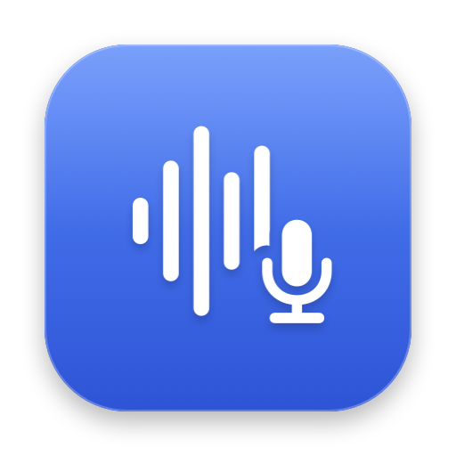
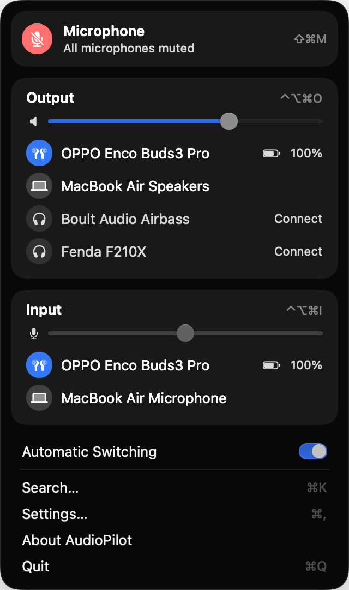
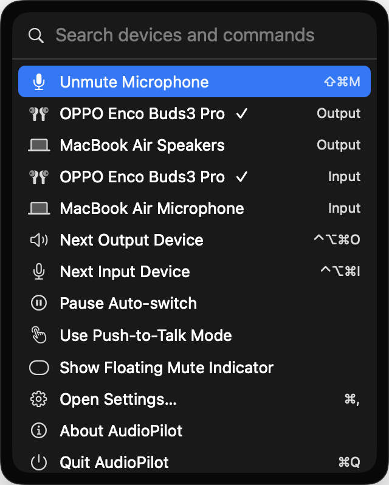
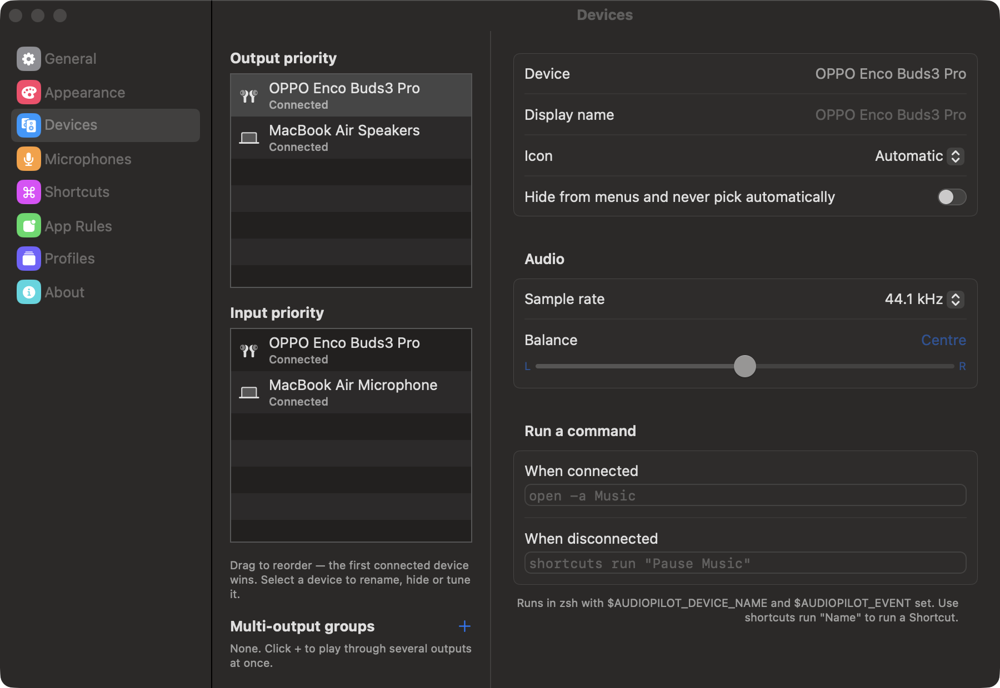
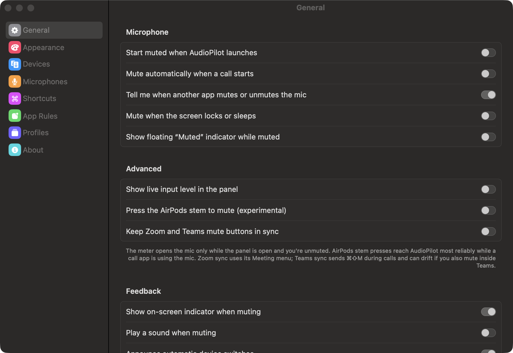
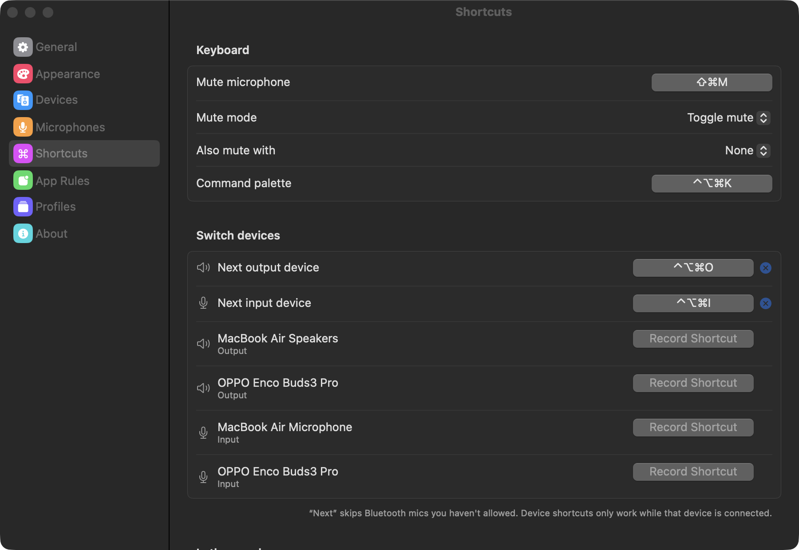
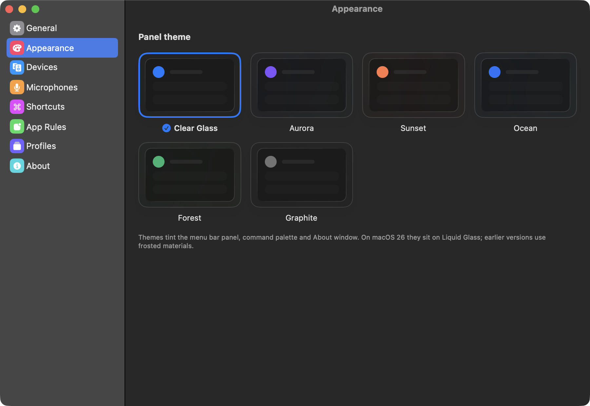
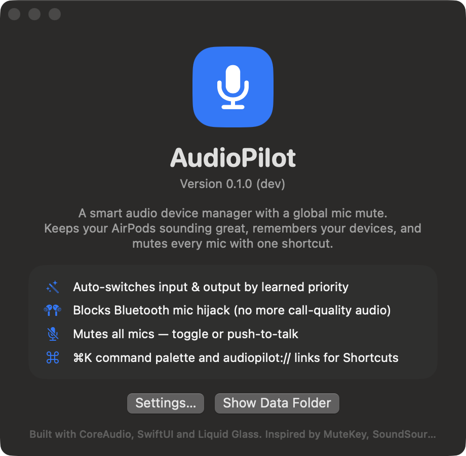

# AudioPilot

[](https://github.com/Clumsynite/audiopilot/actions/workflows/ci.yml)
[](https://github.com/Clumsynite/audiopilot/actions/workflows/release.yml)
[](../../releases/latest)


A macOS menu bar app that picks the right microphone and speakers automatically, keeps AirPods and other
Bluetooth headsets out of low-quality "call mode", and mutes every mic with one shortcut.

<p align="center">
  
  &nbsp;&nbsp;
  
</p>

## Features

**Devices**
- Auto-switches input and output by a priority list it learns from your choices; new devices take over when connected.
- Blocks Bluetooth mics by default, so AirPods keep high-quality audio; allow one with a click.
- Per-app rules (e.g. "use the USB headset while Zoom is running") and profiles (Home, Office…) that can follow your Wi-Fi network.
- Rename devices, change their icons, hide the ones you never use, set sample rate and balance.
- Bluetooth battery levels, one-click connect for paired headphones, multi-output groups, and scripts that run when a device connects.

**Mute**
- ⌘⇧M mutes every physical mic (toggle or push-to-talk), with a glass on-screen indicator that names the mic.
- Also mute with the Globe key or a mouse button, pressing an AirPods stem (experimental), or automatically when a call starts.
- Shows which app is using the mic; warns when another app changes your mute; optional Zoom/Teams mute-button sync.
- Mute stays applied when you switch devices, plug in a new mic, or wake the Mac.

**Everywhere**
- ⌘K command palette (or just start typing in the panel), global shortcuts for next input/output or any specific device.
- Spotlight and Shortcuts app actions: "Mute Microphone", "Switch Audio Device", "Next Output Device"…
- `audiopilot://` links for Shortcuts, Raycast, Alfred, Stream Deck and scripts.

<p align="center">
  
  
</p>

## Install

1. Download **`AudioPilot-<version>.dmg`** from the [latest release](../../releases/latest).
   (This repository is private: you need access to it, or run `gh release download -R Clumsynite/audiopilot -p '*.dmg'`.)
2. Open the disk image and drag **AudioPilot** to **Applications**.
3. Open AudioPilot from Applications. A mic icon appears in the menu bar (there's no Dock icon).

**First launch of an unsigned build.** Releases are ad-hoc signed unless the Developer ID secrets are
configured (see [Releasing](#releasing)). macOS then says it can't verify the app. Click **Done**, open
**System Settings › Privacy & Security**, scroll down and click **Open Anyway** next to AudioPilot.
Alternatively, in Terminal:

```sh
xattr -dr com.apple.quarantine /Applications/AudioPilot.app
```

**Updating:** quit AudioPilot, drag the new version over the old one, and open it again. Settings are kept.

**Permissions** — AudioPilot only asks when you turn on a feature that needs one:

| Feature | Permission |
|---|---|
| Level meter, AirPods stem mute | Microphone |
| Globe key / mouse button mute | Input Monitoring |
| Zoom / Teams mute sync | Accessibility |
| Connect Bluetooth headphones | Bluetooth |
| Switch profile by Wi-Fi network | Location (to read the network name only) |

Device switching, muting, the panel, shortcuts and Spotlight need no permissions.

## Using it

| | |
|---|---|
| **Click** the menu bar icon | Panel: mute, devices, volume, search |
| **Right-click** / **⌥-click** the icon | Quick menu / toggle mute |
| **⌘⇧M** | Mute or unmute every mic |
| **⌃⌥⌘K** | Command palette from anywhere |
| **⌃⌥⌘O** / **⌃⌥⌘I** | Next output / input device |
| **⌘,** in the panel | Settings |

All shortcuts can be changed in **Settings › Shortcuts**, which also lists every `audiopilot://` link:

```sh
open "audiopilot://toggle"                     # toggle mute
open "audiopilot://output?name=AirPods"        # switch output by (partial) name
open "audiopilot://next?dir=input"             # next input device
open "audiopilot://run?id=mute.on"             # any action ID (see Sources/AudioPilot/Actions.swift)
```

<p align="center">
  
</p>

<details>
<summary>More screenshots</summary>





</details>

## Development

**Requirements:** macOS 26 and Xcode 27 (Swift 6.2+ toolchain, macOS 26 SDK). The app runs on macOS 14 or later.
No Xcode project and no third-party dependencies: it's a Swift package.

```sh
git clone https://github.com/Clumsynite/audiopilot.git
cd audiopilot
swift build                # debug build
swift test                 # unit tests (engine, policy, storage, migrations)
scripts/build-app.sh       # release build → build/AudioPilot.app (ad-hoc signed)
open build/AudioPilot.app
```

**Safe local runs.** These never change your audio settings, write files or register shortcuts:

```sh
BIN=$(swift build --show-bin-path)/AudioPilot
$BIN --list-devices                      # device table (defaults, mute, volume)
$BIN --mic-users                         # apps using the mic right now
$BIN --dry-run --dry-run-seconds 5       # run the engine and print the switches it would make
$BIN --dry-run --test-mute               # how each mic would be muted
$BIN --dry-run --show-panel              # preview UI: also --show-palette, --show-settings <pane>, --show-about, --show-hud muted|live|switch
```

**Layout**

```
Sources/AudioPilotCore/   Pure logic, fully unit-tested: Engine (device-selection reducer), DevicePolicy,
                          Preferences (+ migrations), profiles, JSON storage. Foundation only.
Sources/AudioPilot/       The app: CoreAudio wrapper, mute driver, controllers (Bluetooth, mic usage, Wi-Fi,
                          Spotlight, meeting sync), Carbon hotkeys, App Intents, AppKit/SwiftUI UI.
Tests/AudioPilotCoreTests Swift Testing suites.
scripts/                  build-app.sh, package.sh, bump-version.sh
.github/workflows/        CI (build + test on every push/PR) and Release (on version tags).
```

Device choices live in `Engine.reduce(_:now:)`, a deterministic reducer: CoreAudio and app events go in, actions
(`setDefault`, `savePrefs`, …) come out. Add a test in `EngineTests` for any change to how devices are picked.

Settings are stored in `~/Library/Application Support/AudioPilot/` (settings from MuteMe, the app's earlier name,
are copied over on first launch).

## Releasing

```sh
scripts/bump-version.sh minor      # or patch / major / 1.4.0 — updates Info.plist, commits, tags vX.Y.Z
git push origin HEAD --follow-tags
```

The tag starts the **Release** workflow, which tests, builds, packages `AudioPilot-X.Y.Z.dmg` + `.zip` with
SHA-256 sums, and publishes a GitHub Release with generated notes. The build number is the commit count.

To ship signed and notarized builds (no Gatekeeper prompt), add these repository secrets:
`DEVELOPER_ID_P12` (base64 of a Developer ID Application `.p12`), `DEVELOPER_ID_P12_PASSWORD`, `APPLE_ID`,
`APPLE_TEAM_ID` and `APPLE_APP_PASSWORD` (an app-specific password). Without them releases are ad-hoc signed.

## Known limitations

- No "you're talking while muted" warning: AudioPilot mutes the hardware, so no app (including this one) hears you.
- The orange mic-in-use dot stays on while muted; only the app capturing audio can clear it.
- Apps that open a Bluetooth mic directly (not via the default input) can still switch a headset to call quality.
- Teams sync toggles with ⌘⇧M and can drift if you also mute inside Teams.
